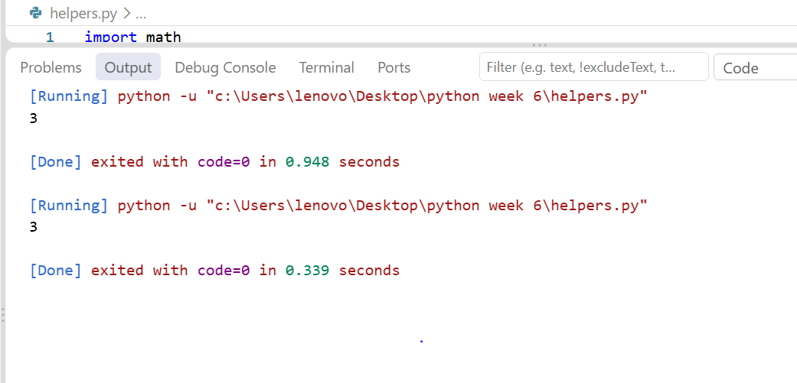
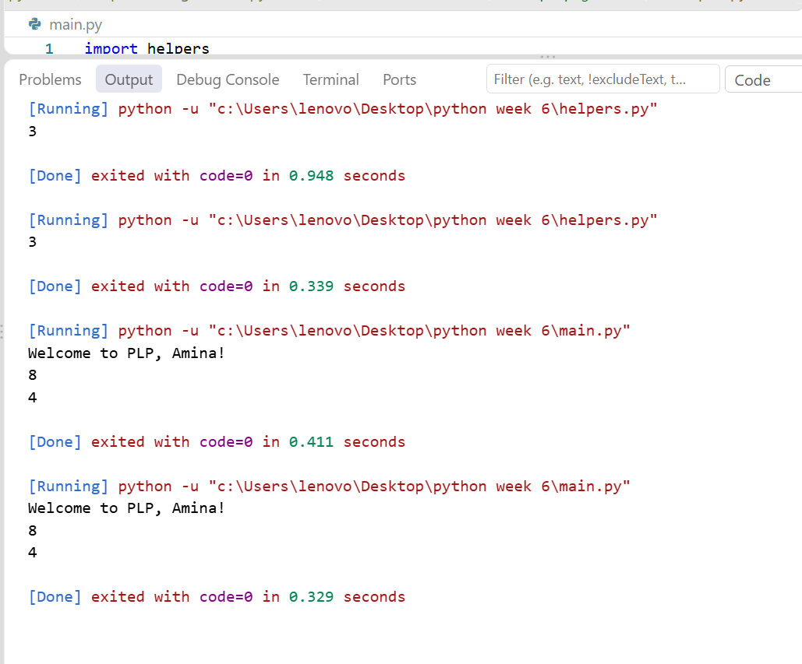

# Python Week 5 - Functions and Modules

## What I did
- Created helpers.py with welcome() and tables_needed() functions
- Created main.py that imports helpers
- Created password_generator.py that generates random passwords

## Screenshots

### helpers.py output

### main.py output

### password_generator.py output

## Author
Amina